# RAG 产品 UI 调研与截图

收集日期：2026-11-03。覆盖 6 款代表性产品，不是市场全部产品。图片来自官方文档或官方 GitHub 图片仓库，保留原始标注；没有现场登录实测，没有重绘或生成产品界面。点击图片可放大，点击原图可查看原始尺寸。

## 结论

成熟产品普遍提供知识维护界面。此次证据集中在分类/标签、解析/分块预览、片段修订、启停、检索测试；不应把这些等同于自动内容可信度评估。

推荐组合：FastGPT 导入流程 + RAGFlow 原文对照 + MaxKB 标签维护 + 千帆命中测试。你的业务另加材料用途、适用业务、生效版本，以及缺失字段/表头的待处理提示。

## Dify：文档管理与片段维护

官方文档截图，未标注精确应用版本。

把资料列表与片段详情分开；启停和归档是维护入口，不能据此认定有自动质量评分。

### 文档列表与批量操作

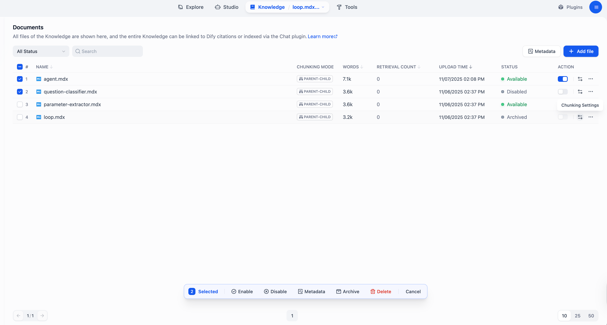

[官方来源](https://docs.dify.ai/en/cloud/use-dify/knowledge/manage-knowledge/maintain-knowledge-documents) · [原图地址](https://mintcdn.com/dify-6c0370d8/Z6MqdkI3dck9_1H6/images/use-dify/knowledge/manage-knowledge-documents.png?fit=max&auto=format&n=Z6MqdkI3dck9_1H6&q=85&s=fa9ecc455e91a4bd78902dfaa8959890)

### 片段内容与文档信息

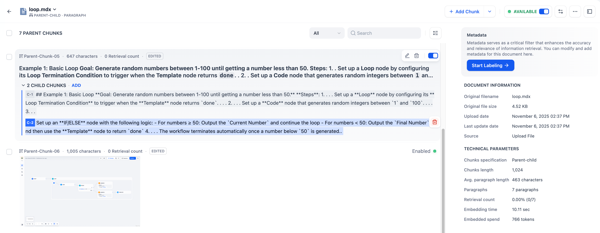

[官方来源](https://docs.dify.ai/en/cloud/use-dify/knowledge/manage-knowledge/maintain-knowledge-documents) · [原图地址](https://mintcdn.com/dify-6c0370d8/Z6MqdkI3dck9_1H6/images/use-dify/knowledge/manage-document-chunks.png?fit=max&auto=format&n=Z6MqdkI3dck9_1H6&q=85&s=3b58f3fa398adfc511e8d7b7f5a1d855)

## RAGFlow：解析结果对照与修订

官方文档 DEV 页面引用截图，图片可能来自较早版本。

最值得参考的是原文和解析片段并排显示；用户能发现表格错位、缺内容，并修订片段。

### 解析策略配置

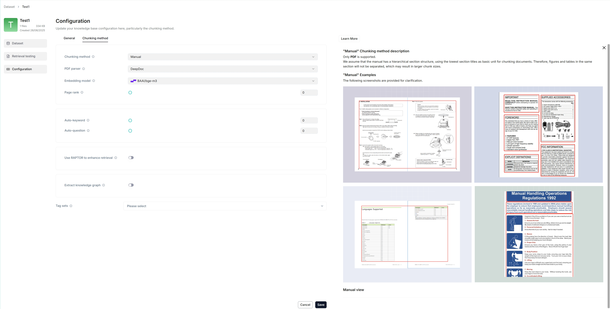

[官方来源](https://ragflow.net/docs/configure_knowledge_base) · [原图地址](https://raw.githubusercontent.com/infiniflow/ragflow-docs/main/images/configure_knowledge_base.jpg)

### 文件解析状态

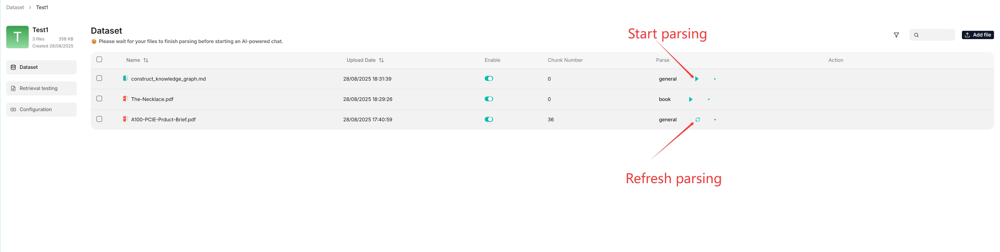

[官方来源](https://ragflow.net/docs/configure_knowledge_base) · [原图地址](https://raw.githubusercontent.com/infiniflow/ragflow-docs/main/images/parse_file.jpg)

### 原文与解析片段对照

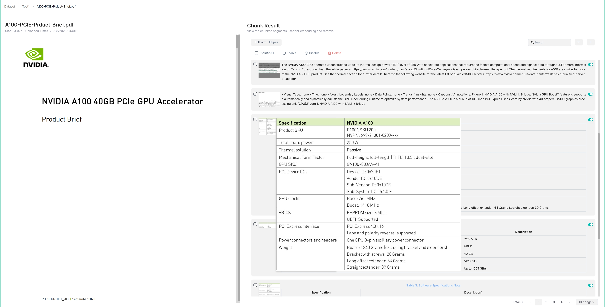

[官方来源](https://ragflow.net/docs/configure_knowledge_base) · [原图地址](https://raw.githubusercontent.com/infiniflow/ragflow-docs/main/images/file_chunks.jpg)

### 修订片段、关键词与问题

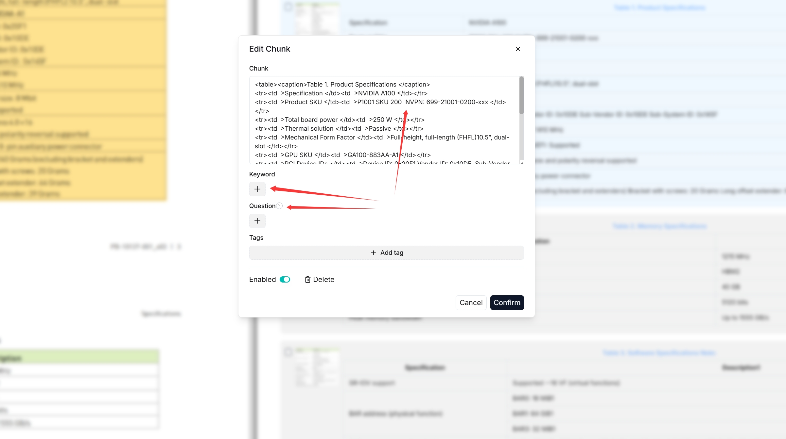

[官方来源](https://ragflow.net/docs/configure_knowledge_base) · [原图地址](https://raw.githubusercontent.com/infiniflow/ragflow-docs/main/images/add_keyword_question.jpg)

## FastGPT：导入前预览

官方快速上手教程截图，未标注精确应用版本。

上传→配置→预览→就绪，把检查分块内容纳入导入过程。预览不是系统自动证明资料正确。

### 上传文件

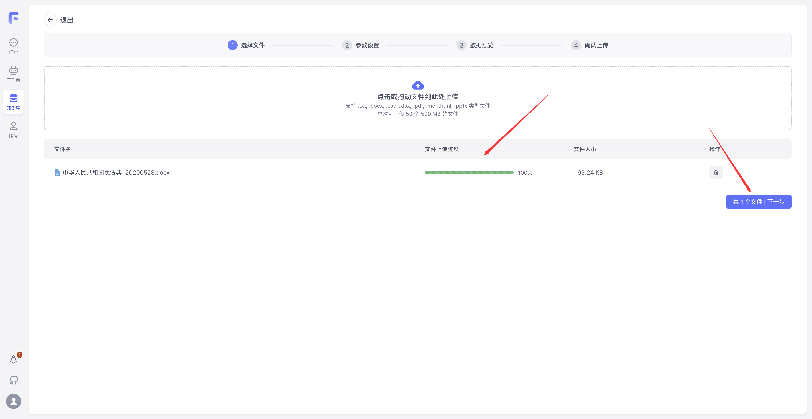

[官方来源](https://doc.fastgpt.io/zh-CN/guide/getting-started/quick-start) · [原图地址](https://cdn.jsdelivr.net/gh/labring/fastgpt-img@main/guide/getting-started/quick-start/image-14.png)

### 解析与分块参数

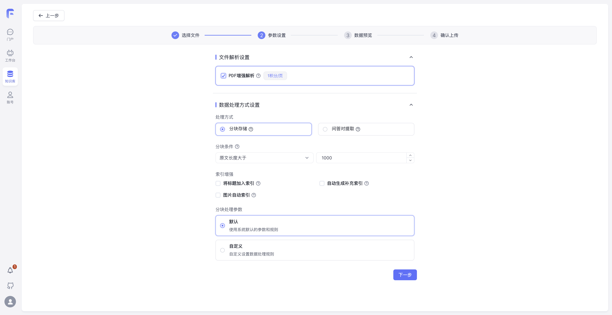

[官方来源](https://doc.fastgpt.io/zh-CN/guide/getting-started/quick-start) · [原图地址](https://cdn.jsdelivr.net/gh/labring/fastgpt-img@main/guide/getting-started/quick-start/image-15.png)

### 入库前预览分块

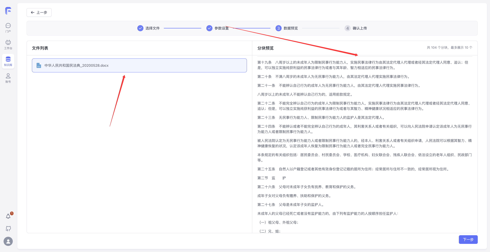

[官方来源](https://doc.fastgpt.io/zh-CN/guide/getting-started/quick-start) · [原图地址](https://cdn.jsdelivr.net/gh/labring/fastgpt-img@main/guide/getting-started/quick-start/image-16.png)

### 资料处理完成与就绪状态

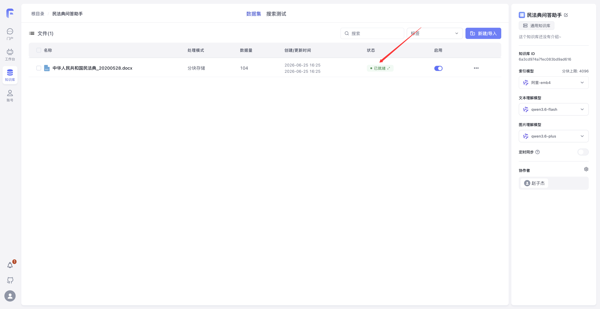

[官方来源](https://doc.fastgpt.io/zh-CN/guide/getting-started/quick-start) · [原图地址](https://cdn.jsdelivr.net/gh/labring/fastgpt-img@main/guide/getting-started/quick-start/image-17.png)

## MaxKB：分类维护、命中测试与入库工作流

官方 MaxKB-docs v2 分支截图；具体版本和商业功能以官方授权说明为准。

适合参考客户知识管理员的操作方式：标签维护、分段修订、试问，以及入库执行详情。

### 文档列表与维护操作

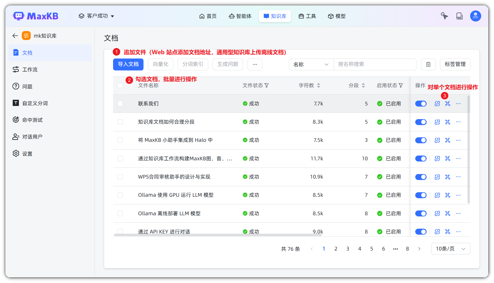

[官方来源](https://github.com/1Panel-dev/MaxKB-docs/tree/v2/docs/user_manual/dataset) · [原图地址](https://raw.githubusercontent.com/1Panel-dev/MaxKB-docs/v2/docs/img/dataset/document_action.png)

### 标签管理

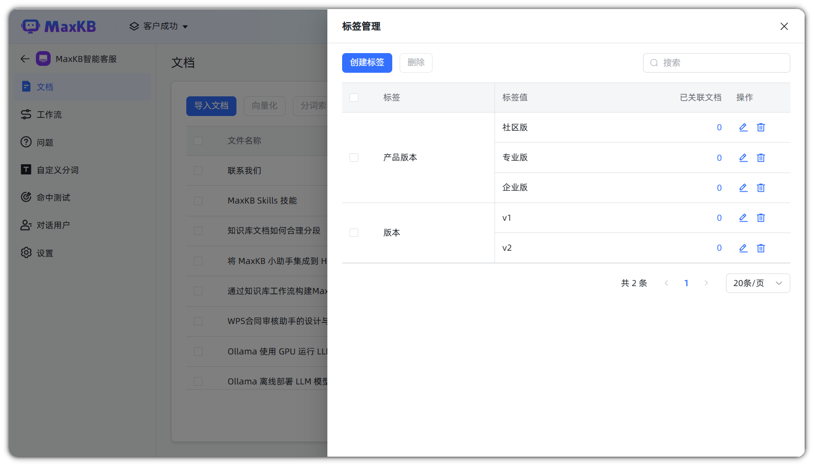

[官方来源](https://github.com/1Panel-dev/MaxKB-docs/tree/v2/docs/user_manual/dataset) · [原图地址](https://raw.githubusercontent.com/1Panel-dev/MaxKB-docs/v2/docs/img/dataset/Tag_Manage.png)

### 分段管理

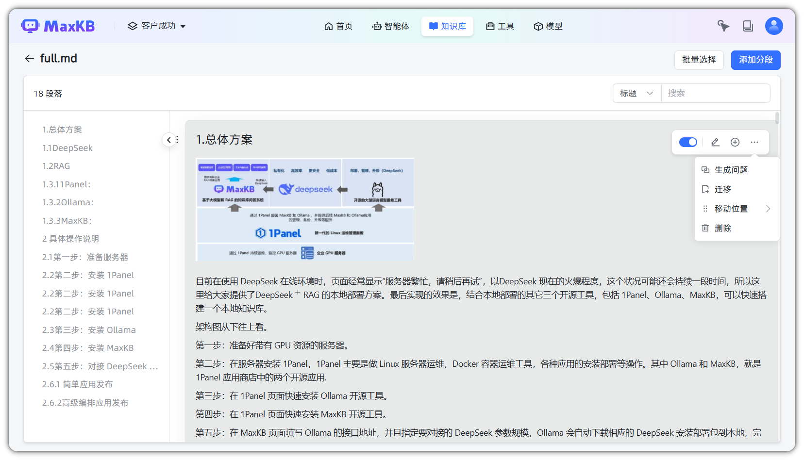

[官方来源](https://github.com/1Panel-dev/MaxKB-docs/tree/v2/docs/user_manual/dataset) · [原图地址](https://raw.githubusercontent.com/1Panel-dev/MaxKB-docs/v2/docs/img/dataset/segmentation_management.png)

### 问题命中测试

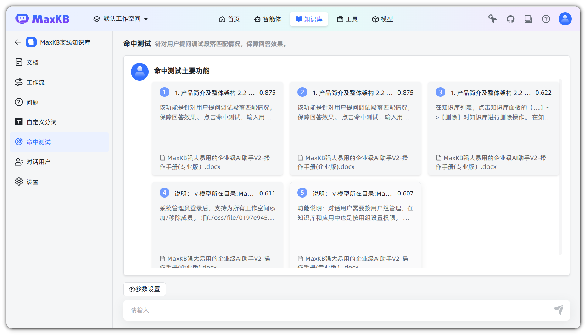

[官方来源](https://github.com/1Panel-dev/MaxKB-docs/tree/v2/docs/user_manual/dataset) · [原图地址](https://raw.githubusercontent.com/1Panel-dev/MaxKB-docs/v2/docs/img/dataset/hittesting.png)

### 知识入库工作流

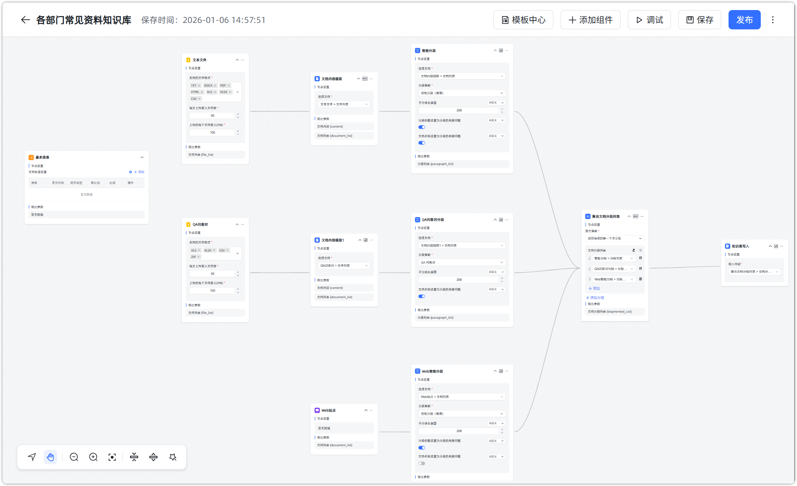

[官方来源](https://github.com/1Panel-dev/MaxKB-docs/tree/v2/docs/user_manual/dataset) · [原图地址](https://raw.githubusercontent.com/1Panel-dev/MaxKB-docs/v2/docs/img/dataset/set_workflow_dataset.png)

### 入库流程执行详情

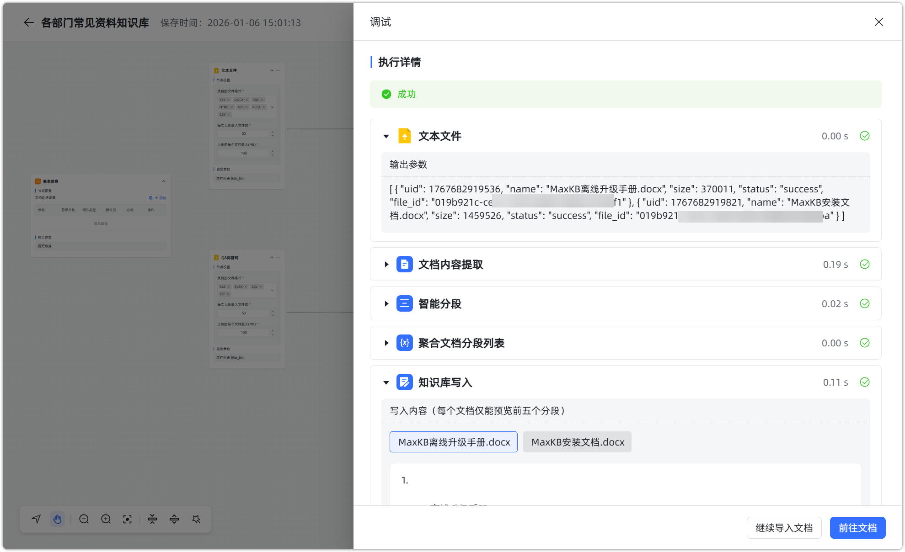

[官方来源](https://github.com/1Panel-dev/MaxKB-docs/tree/v2/docs/user_manual/dataset) · [原图地址](https://raw.githubusercontent.com/1Panel-dev/MaxKB-docs/v2/docs/img/dataset/debug_workflow_dataset1.png)

## 百度千帆：检索范围与命中测试

官方命中测试教程截图，未登录控制台实测。

测试问题、检索配置、结果和历史记录在一个页面内；能定位检索问题，但相似度不是内容正确率。

### 从知识库进入命中测试

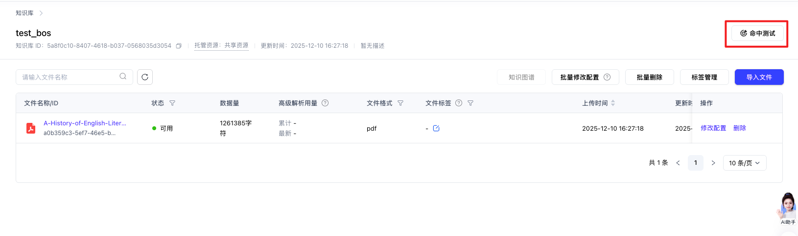

[官方来源](https://cloud.baidu.com/doc/qianfan/s/Dmh4stpqc) · [原图地址](https://bce.bdstatic.com/doc/bce-doc/qianfan/fcf4908279117dcc3b9a0d796_fcf4908.png)

### 检索模式与重排配置

[官方来源](https://cloud.baidu.com/doc/qianfan/s/Dmh4stpqc) · [原图地址](https://bce.bdstatic.com/doc/bce-doc/qianfan/a5c7a6fa06f04c009b7f765f4_a5c7a6f.png)

### 命中结果与测试历史

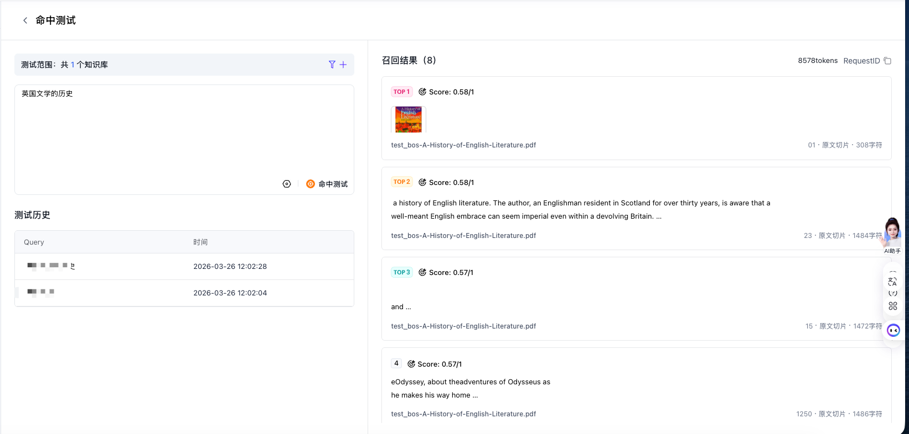

[官方来源](https://cloud.baidu.com/doc/qianfan/s/Dmh4stpqc) · [原图地址](https://bce.bdstatic.com/doc/bce-doc/qianfan/5f7854ad6727872170f17aaa4_5f7854a.png)

### 检索范围筛选入口

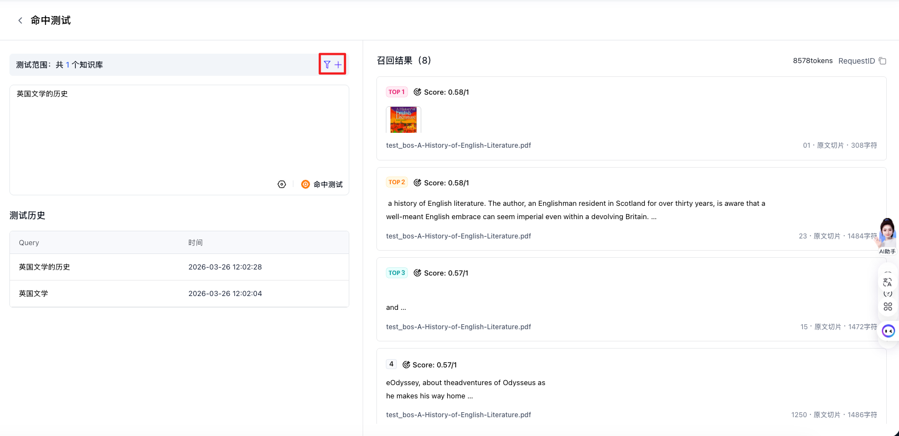

[官方来源](https://cloud.baidu.com/doc/qianfan/s/Dmh4stpqc) · [原图地址](https://bce.bdstatic.com/doc/bce-doc/qianfan/24ccb4f0b4e7c6316d9f5bbf8_24ccb4f.png)

## 阿里云百炼：类目、标签与切片维护（文档核实）

仅取得官方问答示例界面；没有取得可确认的知识管理页面截图。

官方文档明确描述类目、标签、元数据和切片启停等页面操作。下图仅作问答显示参考，不能当作质量管理页面。

### 问答结果展示示例；非知识管理截图

[官方来源](https://www.alibabacloud.com/help/zh/model-studio/rag-knowledge-base) · [原图地址](https://help-static-aliyun-doc.aliyuncs.com/assets/img/zh-CN/1699676371/p903021.png)

## 重要边界

- 相似度不是可信度；解析完成不是业务质量合格。
- 修改原文件、修改片段、重建索引是不同操作。
- MaxKB v2 的替换原文档不会更新既有分段与向量：[原文](https://github.com/1Panel-dev/MaxKB-docs/blob/v2/docs/user_manual/dataset/doclist.md)。
- 百炼此次没有获得知识管理页实图，只收录问答示例：[文档管理说明](https://help.aliyun.com/zh/model-studio/rag/documents)。
- 完整来源和下载情况见 manifest.json。
